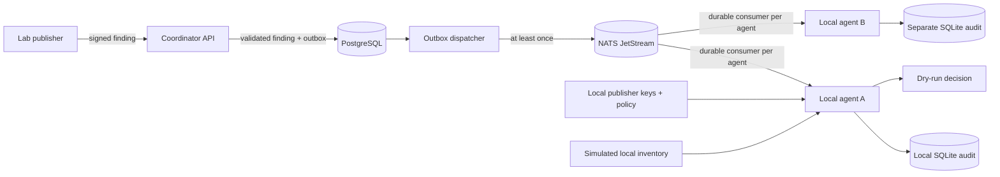

# Architecture

This document records the original dry-run architecture. Phase 3C added a separately authorized disposable fixture path. Phase 4 uses the Phase 3C baseline and the shared contract freeze. [Phase 3C integration](docs/phase3c-integration.md) · [Phase 4 plan](docs/phase4-integration-plan.md)

## Objective and boundaries

Aegis Mesh accepts and distributes signed findings with verifiable provenance and evidence digests. Aegis Rapid runs at each authorized lab deployment, independently verifies the publisher, compares exact inventory identities, and records a local policy decision. The current implementation only computes dry-run decisions. It neither fetches evidence URLs nor executes mitigation commands.

## Trust and plane separation

- **Intelligence plane:** future OSS-CRS/Buttercup workers produce findings and immutable evidence digests in disposable, network-restricted labs. No LLM is on the execution path.
- **Control plane:** FastAPI validates a signed artifact against coordinator-pinned publisher keys, writes it and an outbox entry atomically to PostgreSQL, then publishes through JetStream. It never supplies a local policy or command.
- **Enforcement plane:** the agent has its own publisher keys, lab authorization flag, allowed template IDs, exact inventory, and SQLite audit. It rechecks the signature and expiry and defaults to deny. The current output is a dry-run decision. Later enforcement must be a separate, narrowly privileged template executor with preflight, independent test, health check, and rollback.

The coordinator and each agent load separate local trust files. A trust grant binds publisher ID and key ID to an Ed25519 public key, allowed roles, validity interval, and optional revocation time. Event payloads contain no private key or authorization. A coordinator cannot grant local authorization by changing an event.

## Artifact v1 and versioning

`SignedFinding` contains a `finding` plus base64 Ed25519 signature over canonical UTF-8 JSON (sorted keys, compact separators). Unknown fields and unknown schema versions are rejected. A finding includes `artifact_id`, `publisher_id`, monotonic `sequence`, issue and expiry times, vulnerability ID, package URL, exact affected versions, evidence records (`uri`, SHA-256 digest, method), lab applicability, and a mitigation template **identifier**. The template identifier is data only: no shell, script, URL fetching, or executable arguments are present.

Phase 2 adds a signed revocation event referencing an artifact ID and digest. A publisher key must have the revocation role, and each agent keeps its own durable revocation ledger. The event is a dry-run trust control; it never triggers an action. Formal version ranges, CycloneDX BOM references, in-toto attestations, TUF metadata, and full root-key rotation remain outside this phase.

## Delivery and replay

PostgreSQL has unique event IDs and publisher/sequence pairs. Each accepted event creates a transactional outbox row. The dispatcher uses the event ID as a JetStream message ID and marks the row sent only after publish acknowledgement. A crash between publish and mark can duplicate a message; each agent's audit deduplicates by event ID after revalidation. Each agent has a unique, stable durable consumer name and separate SQLite audit. The agent rejects a lower or equal authenticated publisher sequence for a new event. Invalid signatures are logged separately and cannot raise that watermark. JetStream durable consumers use explicit acknowledgement and at most five deliveries. Expired or unauthorized data produces a denied dry-run decision.

Phase 2A tests two independent Compose agents. Simulations of 3, 10, and 100 agents with separate consumers and SQLite stores remain planned. Concurrent writers for one agent ID, complete audit tamper resistance, coordinator failover, and unbounded offline catch-up remain outside the phase.
