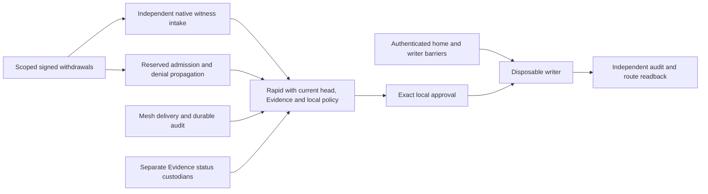

# Phase 4E architecture

## Approved baseline and authority boundary

The common integration baseline is Phase 4D `ae59a97becfdbf9fb79c7cc89c0a27c662fb9a9f`, tree `60b9ee8d64f4e43857252dd9d79e6e4b44b95461`. The clean baseline combines the native T3–T5 controls at the disposable fixture writer. T6 independently failed the distributed enforcement gate. Phase 4E may exercise native trust and signed local denial in authorized lab fixtures. The distributed writer stays disabled through Phase 4E review. Research, Evidence, Mesh and any external attestation supply inputs. Only the enrolled local operator can approve the exact target plan. [Phase 4D security review](phase4d-security-review.md) · [Phase 4D release decision](phase4d-release-readiness.md)

## Workstream interfaces and failure policy

| Owner | Responsibility and invariant |
| --- | --- |
| A · Withdrawal priority | Reserve bounded service capacity for authenticated scoped denials and preserve ordinary progress. Preserve atomic event, journal and outbox state, stable IDs and commit-before-ACK. An earlier same-publisher finding must retain its ordering dependency unless a new versioned signed denial lane has been approved. A fast withdrawal observation can only invalidate or hold. Broker acknowledgement is delivery telemetry. |
| B · Cross-broker identity | Authenticate the transport principal and broker context against local enrollment. Bind proof-of-possession, deployment, allowed broker, session and home generation. A successor receives active write authority only after all enrolled writers durably raise their fences and the home independently confirms the same barrier. Check exact intent, generation, target fence and expiry at each mutation. A storage restore or ambiguous owner remains unavailable. |
| C · Independent Trust | Admit original signed records across separately governed paths. Use the native witnessed history, independent Evidence status, retained scoped tombstones and monotonic continuity floors. Certify a requested native scope, checkpoint, audience and expiry. Missing records, stale content, contradictions, unreachable authorities or integrity failures remove eligibility. Protect source, proof and status services with scoped, authenticated, bounded interfaces. |
| D · Independent validation | Run healthy and fault controls against the exact integrated pin. Inspect writer fences and audit independently, and have a separate observer verify marker and benign responses. Record attempted, denied, committed, confirmed and safely recovered states explicitly, including censored or failed cases. |

## Chosen distributed fault model

Assume a compromised or unavailable coordinator, delayed, duplicated or withheld broker traffic, stale former agents, process crashes, independently restored application stores and network partitions. Reuse the T4 3-of-4 fixed witness roster with at most one faulty or Byzantine witness for post-cutoff coverage of quorum-admitted events. Coverage depends on independent intake and durability of witness obligations. T5 requires both pinned status operators on a current complete view and two eligible verifier organizations separate from local approval. Losing either status operator can deny availability. These policies and their evidence requirements stay distinct. Scope remains one cohort and its explicitly enrolled lab fixtures.

Trusted assumptions include a trustworthy enrollment root and local approver, an independently protected continuity anchor, target adapters that apply generation changes and exact plan checks in their mutation boundary, and a measured bound on clock uncertainty. Rotated or restored actors must prove continuity before rejoining. A hostile local writer, unsafe clock or anchor recovery, or collusion beyond the declared threshold invalidates the corresponding positive result. Repair or quarantine can restrict known paths, record uncertainty and require independent readback. Repair cannot infer renewed authority from a healthy endpoint.

## Safety and measurement

When status is unavailable, the writer denies new authority and unsafe rollback. Known denials survive broker loss and recovery. An in-flight plan is invalidated after observed interruption. An unknown withdrawal before a sealed/current view is bounded by the earliest applicable cutoff, status, ownership, approval and actuator deadline. The gate compares durable generation and exact immutable plan inputs before each protected commit. A receipt or fresh transport lease alone carries no authority.

Time withdrawal admission, delivery and confirmed denial independently. Admission starts when the relevant authority durably accepts a scoped withdrawal. Denial ends when the independent observer verifies the safety state for an eligible fixture. Measure an unreachable agent's lost-lease restrictive deadline separately from its process reclaim and eventual broker ACK. Track a still-valid prior cut's residual interval, backlog age, capacity rejections, service disruption, restart recovery, and greatest clock error on each host. The historical five-second threshold was a reporting threshold. Phase 4E must establish any denial bound separately in the declared lab topology. [Test ledger](phase4e-integration-plan.md)
