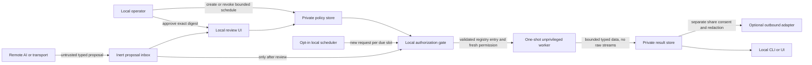

# Phase 5C-1 — restricted Diagnostic Runner architecture

**Status:** architecture proposal only, based on `ec939e14a5acd438ff0d5fa562ed61a70b68f3c9`. No execution path, daemon, timer, transport, permission grant or install artifact is implemented here. The proposed runner is a separate unprivileged local component. It does not change SignedFinding 1.0, Rapid, native T4/T5, or any protected writer.

## Existing boundary and design decision

The Phase 5B source CLI (`src/aegis/cli.py`, `local_observer.py`, `docs/phase5b-linux-cli.md`) is on demand, offline and observation only. It reads bounded Debian/Ubuntu `dpkg` status; implicit invocations leave no state, and `--state-dir` creates only a private random asset ID. Its signed file adapter verifies original Finding 1.0 and local publisher grants, but an exact package match still has `independent_status=unknown`. The installable console entry point is withheld at this pin. Its 100,000-row/256 MiB resource failure and Linux install/tracing gates remain open (`docs/phase-next-r-acceptance-frozen.md`). The runner must not inherit a release claim from source-level CLI tests.

Rapid (`src/aegis/core.py`) independently checks signature, local grant, exact `(purl, version)` inventory, template and lab authorization, and durably audits dry-run decisions. The Phase 3C disposable fixture (`src/aegis/mitigation/policy.py`, `phase3c.py`) grants a short process-local approval for an exact reviewed plan. Native Trust/Evidence and target fences are separate authority inputs (`docs/phase5-schema-authority.md`, `docs/phase4f-architecture.md`). Diagnostic consent is a **new, lower-authority permission domain**: a diagnostic result cannot be a Rapid decision, Evidence proof, signed Finding, mitigation plan or target capability. Existing `TrustStore` roles are `finding` and `revocation`, not diagnostic execution roles.

**Recommended approach:** keep Phase 5B's default CLI unchanged. Add a separately installed, opt-in, unprivileged runner with a closed registry, local-only authorization database and bounded one-shot worker. On-demand local checks can later use that same worker. A remote AI can submit a typed suggestion to an inbox, but no transport credential, signature, model text or Mesh event may start a worker or grant consent. The local operator or a preconfigured local rule makes that decision. The initial release should require exact per-request approval for remote suggestions; standing remote-suggestion rules are deferred until independently reviewed. Scheduled diagnostics use explicit local standing consent.

## Data flow and trust boundaries

1. An ingress parser applies size, depth, UTF-8 and schema limits. It stores a remote proposal as inert data and never trusts its `source` label, claimed identity, priority or timestamps. A local adapter creates `DiagnosticRequest/v1` after validation. No free-form command, executable, path, URL, host, port range, script or environment value is accepted as an operation argument.
2. The gate pins a compiled `Registry/v1` entry by exact operation ID and version. It rejects unknown versions/fields and unsupported platform features. It evaluates local permission, exact argument digest, install audience, purpose, expiry, revocation generation, rate cap and cumulative budget, then records an atomic one-time admission before dispatch. A local schedule creates a fresh request ID for each due slot; it is not a replay of its template.
3. The worker uses only the relevant least-privilege OS read interface. It returns an allowlisted structured result. Failure, timeout, truncation, partial inventory or ambiguous state is `unknown`/`incomplete`, never healthy or safe. The gate rechecks revocation before publishing or sharing a result. No diagnostic can import Rapid's writer path, `LocalOperator`, or target store.
4. Local viewing and outbound sharing are different permissions. The default is local-only. A result is never sent merely because the remote source suggested the operation. The outbound adapter, if later built, accepts only a locally approved result ID, destination and disclosure tier; it has no worker-launch API.

## Closed operation registry v1

The registry ships with code and has a reviewed digest recorded in each result. No remote registry update, plugin loading, dynamic shell template, user-supplied executable or fallback to an unknown operation is permitted. New behavior requires a new operation version and independent review. Registry limits below are **proposed starting ceilings**, not measured performance claims; acceptance trials may lower them. A single process may have at most one active check and six checks per hour by default; local policy may only reduce these ceilings. Total daily CPU allowance is 60 s and total local result storage 5 MiB. The queue holds at most 32 proposals and 16 scheduled entries.

| Exact ID | Typed arguments | Read interface and limitation | Default local result | Upper per-run budget |
| --- | --- | --- | --- | --- |
| `inspect_package/v1` | `package_name`: Debian binary package name, 1–128 ASCII characters matching the CLI's package grammar | Reuse the bounded Phase 5B Debian/Ubuntu `dpkg` status reader; exact binary name and raw version. A missing/partial inventory is unknown, not absent. No `apt`, package scripts, repository refresh or version-range inference. | `installed`/`absent`/`unknown`, exact version only in local detail | 3 s wall, 2 s CPU, 128 MiB worker memory, 4 KiB canonical result |
| `check_service/v1` | `unit_name`: pre-enrolled exact `.service` name, lowercase ASCII letters/digits plus `_.@-`, ≤128; no slash, escapes, template wildcard or leading `-` | Prefer read-only systemd D-Bus `GetUnit`/selected properties through a narrow adapter. If that cannot be confined, a separately reviewed fixed `/usr/bin/systemctl show` argv with selected properties and `--` may be used. Query only the local system manager; no `start`, `restart`, unit file reads, journal or process arguments. Failure to reach manager is unknown. | `active`/`inactive`/`failed`/`unknown`; never claim application health | 2 s wall, 1 s CPU, 64 MiB worker memory, 2 KiB result |
| `check_listening_ports/v1` | `family`: `inet`/`inet6`/`both`; `protocol`: `tcp`/`udp`/`both`; `detail`: `counts`/`ports` | Parse bounded `/proc/self/net/tcp{,6}` and `/proc/self/net/udp{,6}` in the runner's **host network namespace**, with no packet send, process traversal, PID lookup or socket ownership attribution. TCP LISTEN is explicit; UDP reports bound sockets, not a proven listener. Namespace access/visibility limits become unknown. Do not use `PrivateNetwork=yes` for this worker, since it would observe a different namespace. | Coarse counts by protocol/family; exact port numbers require separate local detail consent | 2 s wall, 1 s CPU, 64 MiB worker memory, 4 KiB result and ≤256 distinct ports |

Package input is a name, not a path. Service names require a local allowlist in addition to grammar validation; remote text cannot select a new unit. Port enumeration has no user-supplied range or host. A port result cannot establish exposure through a firewall or network reachability. `/proc/net` reflects the caller's network namespace, which is why the worker must pin and report namespace scope; UDP tables represent bound sockets rather than TCP LISTEN state ([Linux proc network manual](https://www.man7.org/linux/man-pages/man5/proc_pid_net.5.html)). Debian's package query interface uses the status database under `/var/lib/dpkg`; this proposal reuses the existing bounded reader instead of invoking a package manager ([dpkg-query manual](https://manpages.debian.org/unstable/dpkg/dpkg-query.1.en.html)).

## Proposed records and validation

The normative draft field sets, examples and compatibility rules are in [Phase 5C schemas](phase5c-diagnostic-runner-schemas.md). `DiagnosticProposal/v1` is untrusted; `DiagnosticRequest/v1` is locally minted; `DiagnosticSchedule/v1` and `DiagnosticAuthorization/v1` live only in the private policy store; `DiagnosticResult/v1` is a private observation. Every record uses an exact string version, strict field set, bounded strings/arrays and canonical JSON for digests. Schema parsing is necessary but insufficient: semantic checks validate actual install ID, operation/argument combination, trusted local origin, monotonic admission, grant generation and current registry digest. An unsupported version fails closed. Version 1 readers never silently reinterpret v2.

## Consent, permission and privacy matrix

`none` means no standing permission. Consent is shown locally with exact operation/arguments, frequency, purpose, result detail, retention and any sharing destination. Declining or revoking is always available locally. Approval of one proposal cannot authorize a future proposal, even with identical arguments. Schedules require an explicit bounded term (maximum 30 days), renewable only by a fresh local act. A user can narrow a grant at any time; widening requires new consent. No first-run background task or implicit identity creation.

| Action or datum | Manual local check | Local schedule | Remote suggestion | Outbound share |
| --- | --- | --- | --- | --- |
| Request creation | Local operator | Locally authored schedule only | Inert proposal; local UI mints request | Cannot create request |
| Run permission | One exact local action | Standing exact operation/args, cadence and expiry; fresh check each run | Exact one-time local approval after review; no remote standing rule in v1 | Separate per-destination local grant |
| Package name/version | Locally visible | Requested package result stored locally | Remote sees nothing on proposal submission | Default `installed`/`unknown`; version only if separately selected |
| Service name/state | Locally visible for allowlisted unit | Only that allowlisted unit | No arbitrary unit expansion | Default state only; unit name only if selected |
| Ports | Counts by default; exact list needs detail consent | Counts only in v1 schedule | Counts only after exact local approval | Counts only; no address, PID, process name or exact port in v1 outbound |
| Audit | Local metadata | Local metadata | Proposal/approval/denial metadata | Share decision and destination receipt metadata |

No hostname, username, machine ID, IP address, environment, command line, raw stdout/stderr, service description, package maintainer field, PID, socket inode or user file enters a result. The existing optional random CLI asset ID is not automatically reused as a remote tracking ID. Result IDs are random per run. Exact versions and port lists can fingerprint a machine; they remain local under explicit detail permission. Aggregate counts may also be sensitive, so sharing is separate and off by default. The UI must show the precise fields that would leave the host before consent.

## Scheduling, resource isolation and offline behavior

An opt-in **user** systemd timer plus one-shot user service is the preferred Linux scheduler, with an in-process local schedule ledger deciding which exact entries are due. Keep `Persistent=false`: missed intervals are skipped, never burst-replayed after boot. Minimum interval 1 hour; at most 16 entries; deterministic per-install jitter up to 5 minutes; one run per `(schedule_id, due_slot)`. Use monotonic time for a running job and wall time only to determine slots and expiry. A backward clock jump suspends schedules until a trusted local clock is restored or the operator reviews them; a forward jump cannot trigger more than one run per entry in an hour. Do not install or enable the timer without explicit opt-in. systemd documents that `Persistent=true` can immediately catch up missed calendar runs, supporting the skip choice ([systemd.timer](https://www.freedesktop.org/software/systemd/man/latest/systemd.timer.html)).

The launcher runs as an ordinary user with no capabilities or privilege escalation. It uses a fixed worker path from the installed package, a fixed empty/minimal environment, no shell, no inherited file descriptors except explicit pipes, fixed cwd, closed stdin, and an argv built solely from registry code and validated typed fields. Resolve and verify the installed executable or module at install time; reject world-writable or unexpected path ownership. Terminate the entire worker cgroup/process group on deadline, then reap it. Bound stdout and stderr together to 16 KiB while reading concurrently; exceeding that cap fails the run. Keep only a parsed allowlisted result and a generic failure code. The systemd property response is capped at 8 KiB; each selected `/proc/self/net` table at 1 MiB and 10,000 rows. The existing `dpkg` reader caps remain 64 MiB, 16 KiB per line and 100,000 installed rows; the proposed package worker must demonstrate its lower memory ceiling, likely with a streaming targeted lookup, before adoption. Disable core dumps. Prefer cgroup v2 or systemd `MemoryMax`, `TasksMax`, CPU quota and `RuntimeMaxSec` for a **group** limit; meter cumulative group CPU against the per-run ceiling as well. Apply `RLIMIT_CPU`, `RLIMIT_AS`, `RLIMIT_FSIZE`, `RLIMIT_NOFILE` and a wall watchdog as additional per-process bounds. `RLIMIT_AS` limits address space rather than resident memory, and `RLIMIT_NPROC` is per real UID, so neither alone establishes the desired group budget ([Linux resource limits](https://man7.org/linux/man-pages/man2/prlimit.2.html), [systemd resource control](https://www.freedesktop.org/software/systemd/man/latest/systemd.resource-control)). If required group isolation is unavailable, the subprocess fallback is disabled. The in-process readers still retain parser and wall/output limits.

Use a read-only filesystem view, private temporary directory, no new privileges, no capabilities and syscall/network restrictions where the OS supports them. Keep access to `/proc/self/net` for the port check and the local system bus for service status; therefore sandbox settings are operation-specific and must be validated in the target user-service environment. systemd notes that some namespacing controls may be unavailable for user services, and `PrivateNetwork` changes the observed network namespace ([systemd.exec](https://www.freedesktop.org/software/systemd/man/latest/systemd.exec)). Isolation failure is an `unsupported` result, never a reason to run unsandboxed. No diagnostic initiates outbound network traffic. Offline collection, scheduling, local review, revocation, audit and cleanup remain available. Remote proposal ingress and outbound result sharing are optional separate adapters; an unavailable connection queues no automatic execution or share and has a bounded local inbox with expiry.

## Audit, retention, replay and uninstall

The private state directory (0700, files 0600, symlinks rejected, owner checked) contains policy, schedules, request replay ledger, proposal inbox, sanitized results and audit. An append-only local audit records timestamp, boot ID, operation/version, registry digest, request/authorization IDs and digests, policy generation, decision reason, start/stop/resource outcome, redaction tier, retention deadline and share destination/receipt. It never stores raw subprocess output or secret values. Atomically commit admission and request ID/digest before spawn; duplicate ID with the same digest returns the previous status, and duplicate ID with different bytes is denied. The replay floor survives restart. A local backup/restore or corrupted ledger cannot grant authority: detect generation rollback with an OS-backed protected marker where available; otherwise suspend remote approvals and schedules until local operator re-enrollment. No unverifiable restored state may be used for positive authorization.

Revoke by increasing the local policy generation, canceling queued/due work, terminating an active worker, invalidating pending shares and recording the denial. Recheck the generation before result visibility/share. A result already shared cannot be recalled, which is shown at consent time. Keep proposal bodies for 24 h, sanitized results for 7 days, and metadata audit for 30 days by default; local policy may shorten them. Expired payloads are removed on startup and daily cleanup. Audit integrity is local tamper evidence (hash chain with protected head), not an independent witness or guarantee against an administrator; deletion/rollback is reported as unknown and disables automatic execution. Avoid identifiers in system journal logging.

Uninstall is a separately explicit local action: disable/stop the opt-in timer and service, terminate workers, revoke grants, remove only the runner-owned unit links and state paths after canonical path/ownership checks, clear inbox/results/replay/audit and optional pseudonymous install ID, and report any paths that could not be removed. Do not remove the Phase 5B CLI's separately opted-in `--state-dir`, Rapid audit, Trust material or shared package database. If the runner is removed without the cleanup action, the package post-remove step must not execute diagnostics; stale private state is reported for manual cleanup. Preserve audit only when the operator chooses export before deletion. Secure deletion of bytes on SSD/snapshots cannot be promised; remove references and recommend encrypted storage for stronger at-rest protection.

## Competing approaches and decision record

| Approach | Benefit | Cost or failure mode | Decision |
| --- | --- | --- | --- |
| Extend Phase 5B CLI with a daemon and `subprocess` calls | Reuses parsing and command surface | Changes its zero-default-state and no-executor guarantee; entangles release gate and parser with background authority | Reject for v1; reuse only the pure package reader behind an adapter |
| Separate unprivileged one-shot runner + opt-in user timer | Small authority surface; offline local schedule; local policy stays local | More packaging and user-service compatibility work; group isolation must be proven | Preferred |
| Privileged system daemon with polkit | Can inspect more host state and enforce stronger unit isolation | Expands privilege and install attack surface; unnecessary for three initial checks | Defer; no privileged enforcement in this phase |
| Shell script / command template registry | Fast to prototype | Shell expansion, injection, ambient environment and arbitrary command drift | Prohibited |
| Pure in-process OS readers only | Avoids subprocess injection and simplifies review | systemd D-Bus adapter complexity; group resource containment weaker if parser hangs | Prefer for package and ports; compare for service |

## Integration boundaries and adoption gates

- Phase 5B may expose a pure bounded package parser, but its existing CLI output, default state behavior and install gate are unchanged. New runner code must not import `agent_runtime`, `phase3c`, mitigation/store, ownership, target writers or audit-writing `LocalAgent.evaluate`.
- Mesh transports signed findings and revocations; neither authorizes diagnostics. A future remote suggestion adapter needs its own message type and cannot put diagnostic payloads into `SignedFinding 1.0`, `TrustStore` publisher roles or the Rapid event stream.
- Phase 5A model output is untrusted research text. It can populate a **typed proposal** only after strict parsing and must never choose an executable, broad selector, result destination or approval outcome.
- Native T4/T5 and protected writers are unaffected. Diagnostic observations are independent local telemetry, not proof of vulnerability, protection, reachability, correct service operation or safe mitigation.
- Before implementation: freeze schemas and registry digest, define the exact user-visible consent UX, verify user-service sandbox availability on pinned Debian/Ubuntu, decide installation/rollback behavior, and run the independent plan in [Phase 5C acceptance](phase5c-diagnostic-runner-acceptance.md). Any shared contract change needs the existing versioned interface review and golden vectors.

See [the threat model](phase5c-diagnostic-runner-threat-model.md) for attack paths and residual risk.
