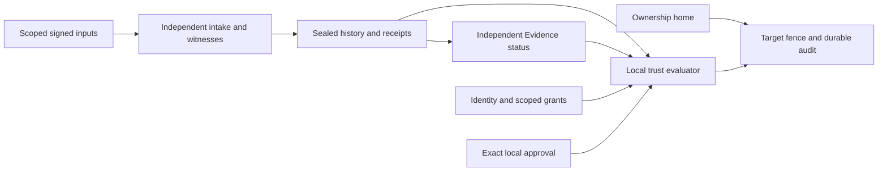

# Aegis Trust architecture

**Decision · 2026-11-19.** Use attested workload identity, one durable ownership home per deployment, independently receipted security history, separately signed Evidence status, and a local evaluator at the target write boundary. Start from Phase 3C `7744ebd7f80e6f2aabb253d5cc3ec9972c86cffd`. Its signed envelopes, replay checks and exact local approval remain useful. Phase 4C `52a4dc43f129e1087fb29b3410dcda389f324c1b` identified the missing completeness, cross-broker ownership, historical trust and Evidence independence guarantees. The T1 identity and transparency research in the original checkout informed this design. [Phase 3C integration](../phase3c-integration.md)

## Identity Authority

Enroll a stable deployment UUID, home, workload identity, instance proof-of-possession key, permitted broker assignments, and target inventory through controlled provisioning. Use SPIRE workload attestation and short-lived X.509-SVIDs with TLS 1.3 mutual authentication. Verify exact peer identities and cohort entitlements on brokers, enrollment, home, recovery, and status endpoints. Disable privileged early data. Application records use Ed25519 with domain-separated bytes. The holder proves possession of the enrolled application key in addition to the transport identity. [X.509-SVID](https://spiffe.io/docs/latest/spiffe-specs/x509-svid/) · [TLS 1.3](https://www.rfc-editor.org/rfc/rfc8446.html)

Distribute scoped role grants and authority rosters through TUF. Use a 2-of-3 offline root and separately administered delegated policy keys. Persist version floors and follow adjacent root rotation with authorization from both root versions. Publisher, verifier, revoker and agent use different keys and role grants. Independent Evidence status, witness, and local approval keys have separate jobs. Routine retirement ends new use. An independently receipted withdrawal from a valid historical interval still applies. An authenticated compromise cutoff puts uncertain historical decisions in hold. Previously installed denials survive. [TUF specification](https://theupdateframework.github.io/specification/latest/)

The prototype loads an explicitly provisioned enrollment, uses a fixed root quorum to authenticate scoped grant snapshots, checks chain order, and verifies agent possession on a per-operation challenge. It models brokers by assignment names. SPIRE, live mTLS and TUF distribution are integration work.

## Durable Ownership and Fencing

One authoritative home serializes deployment ownership across every broker. Production transfers enter a durable preparing state and advance the generation floor at every writer in the approved inventory before the replacement receives authority. Each target checks the generation, holder, local target fence and deadlines in the transaction that commits the effect and audit. Missing barriers pause the handover. Failover must preserve acknowledged generations and fence the former primary.

The prototype puts the home row and one synthetic target in a SQLite transaction domain. The transfer and the single target barrier linearize together. A stale transfer request fails a generation comparison. The effect is a fixed restrictive fixture state. The target increments its own fence after a successful write. Renewal needs a new authenticated operation and exact local approval.

## Independently Witnessed History

Four independently operated witnesses are pinned per cohort. Three signatures certify an admission and three certify coverage. At most one Byzantine operator and durable witness state are required. Two quorums intersect in at least two witnesses. Each honest witness durably records an admission obligation before releasing its signature. It signs a seal only if the complete committed prefix extends its prior prefix and includes every locally receipted event due by that seal. Admission closes at the epoch boundary. A coordinator can withhold data and force a hold, or an independent archive can supply the qualifying cut. Censorship before a quorum receipt is outside the coverage claim.

The prototype replays a full ordered archive of quorum-receipted records and checks a SHA-256 commitment to the canonical ordered receipt bodies. Prefix equality is its consistency proof. Each coverage endorsement binds the checkpoint and the current request nonce. Production should use an RFC 9162-style Merkle tree, indexed range delivery, independent mirrors, and signed coverage statements with an explicit intake cutoff. [RFC 9162](https://www.rfc-editor.org/rfc/rfc9162.html#section-2.1)

## Independent Evidence Status

A separately administered quorum appraises a dedicated Evidence prefix and signs versioned status for the exact finding and evidence digests. The initial pilot should use 3-of-4 status signers and pair the Evidence epoch and policy with Mesh. A relying evaluator repeats the appraisal and requires exact agreement. Positive Evidence requires two eligible organizations other than the submitter. Scoped revocations and eligible contradictions are sticky across expiry and replay. Positive votes, their grants and the finding must still be current. Missing data, signature failure, or status disagreement closes the write gate. Phase 3A remains responsible for material and worker-profile verification when this design is integrated.

The prototype uses a single separately keyed status signer and the same witnessed cut for Mesh and Evidence events. It treats the status signer as a required independent availability check with no ability to override replay. All keys and databases in the prototype run in one test environment. Organizational independence is an operating assumption for deployment.

## Local Trust Evaluator

Bind a one-use random challenge to an enrolled agent and the current generation. Authenticate the response, require three live endorsements of the latest closed epoch, verify and apply the complete prefix from its pinned anchor, and compare exact status. Require a local signature on the exact operation, cut, trust metadata, Evidence status, plan subject, generation, target fence and deadline. The target checks generation and fence again under its write lock. It commits the restrictive state and its success audit together. A separately retained anchor detects rollback or incomplete restoration of the reconciled journal, signed status holds, ownership, and target state. A restart starts without an active challenge. The loss path clears pending authority and keeps already applied fixture restrictions.

Lab timing uses one-second epochs and accepts only the latest closed epoch. Each challenge and approval expires at the earliest relevant limit, including the next epoch boundary. Check wall time and a monotonic deadline. The prototype uses an injected clock in tests. Production budgets require trusted time with an error bound, explicit suspend handling, and a measured exposure limit for events from receipt through target application. A withdrawal admitted after the current cutoff can race a locally valid operation. Known loss stops further writes. During isolation the agent cannot establish a newer global view. A restored or reconnected agent needs authenticated replay and a new exact approval.

See [threat model](threat-model.md), [contract proposal](contracts-proposal.md), [acceptance tests](acceptance-tests.md), and [integration plan](integration-plan.md).
